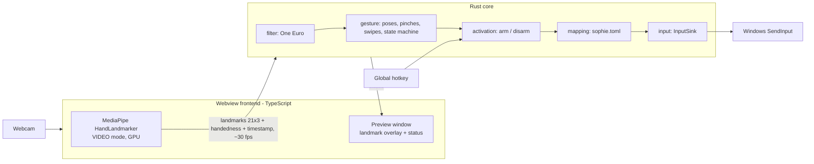

# SOPHIE — Gesture Screen Control (v1) Design

Date: 2026-11-11
Status: Approved for planning

## 1. Goal

SOPHIE is a Jarvis-style desktop agent that lets the user control a Windows PC with
hand gestures captured by a webcam. v1 focuses on one thing: reliable gesture-based
mouse and shortcut control.

### In scope (v1)

- Cursor movement
- Left click, double click, right click
- Drag and drop
- Vertical scroll
- Swipe gestures mapped to hotkeys
- User-configurable gesture → action mapping (`sophie.toml`)
- Arm/disarm via activation gesture and global hotkey
- Windows 10/11 only

### Out of scope (v1)

- Voice commands
- LLM / AI agent features
- Jarvis-style full-screen HUD overlay
- Two-hand gestures
- macOS / Linux

These may become separate sub-projects later, each with its own spec.

## 2. Architecture

SOPHIE is a Tauri 2 application.

- **Webview frontend (TypeScript)** owns perception only: camera capture and the
  official MediaPipe `HandLandmarker` (`@mediapipe/tasks-vision`, VIDEO mode, GPU
  delegate). It streams per-frame landmarks to Rust.
- **Rust core** owns every decision: smoothing, gesture recognition, activation,
  mapping, and OS input injection.

MediaPipe has no official Rust binding, so the webview is used to run the official
JavaScript build while keeping all logic in Rust.



### Why this split

- Gesture logic is testable without a camera: recorded landmark streams can be
  replayed in Rust tests.
- The perception source is replaceable (e.g. an ONNX Runtime pipeline in Rust)
  without touching the core.

### Frame message (frontend → Rust)

Each frame sends:

- `timestamp_ms: f64`
- `hands: Vec<Hand>` where `Hand { handedness: Left | Right, score: f32, landmarks: [[f32; 3]; 21] }`
  in normalized image coordinates (already mirrored so that moving the hand right
  moves the cursor right).

MediaPipe is configured with `numHands = 2`; Rust selects the hand matching the
configured `hand` setting so that a second person's hand is ignored.

## 3. Rust modules

| Module | Responsibility |
|---|---|
| `bridge` | Tauri commands / IPC; receives frames, emits status events |
| `filter` | One Euro filter per landmark; low jitter when slow, low lag when fast |
| `gesture` | Finger state, pinch detection, pose classification, swipe detection, gesture state machine |
| `activation` | Armed/disarmed state; activation gesture, global hotkey, auto-disarm |
| `mapping` | Loads `sophie.toml`, validates, hot-reloads, maps gesture events to actions |
| `input` | `InputSink` trait; Windows implementation using `SendInput` (via `enigo` or `windows` crate) |

## 4. Gesture design

Rule: **one pose, one job.** A pose never triggers two kinds of action, so moving
the cursor cannot accidentally swipe and scrolling cannot accidentally click.

### Default gestures

| Pose | Action |
|---|---|
| Index finger up, others curled | Move cursor |
| Thumb + index pinch, quick release | Left click (two quick taps = double click) |
| Thumb + index pinch, held > 250 ms | Drag (mouse down → move → mouse up on release) |
| Thumb + middle pinch | Right click (remappable) |
| Index + middle up | Scroll (vertical hand movement → wheel delta) |
| Open palm, fast movement left/right/up/down | Swipe → mapped action |
| Open palm held still for 1 s | Toggle arm/disarm |
| Fist or anything else | Nothing (clutch) |

### Design decisions

- **Clutch:** a fist freezes the cursor so the user can reposition the hand, like
  lifting a finger off a touchpad.
- **Swipes only from open palm:** the cursor does not move in open-palm pose, so a
  swipe never drags the cursor across the screen.
- **Cursor anchor:** the cursor follows the midpoint of landmarks 5 and 9 (index and
  middle finger bases), not the index fingertip. Pinching moves the fingertip, which
  would make the cursor jump on every click.
- **Click freeze:** the cursor is frozen for ~120 ms at pinch start.
- **Double click:** no special logic. Two clicks sent quickly with a still cursor are
  recognized by Windows as a double click.
- **Left click fires on release:** required to distinguish click from drag. Clicks
  are delayed by roughly 0.1–0.25 s; accepted trade-off.
- **Cursor, left click, and drag are fixed** and not remappable. They are the base
  mouse vocabulary.

### Recognition details

- **Hand scale:** distance from wrist (0) to middle finger base (9). All distances
  are divided by this so recognition is independent of distance from the camera.
- **Pinch:** normalized fingertip distance. Enter at `< 0.25`, exit at `> 0.35`
  (hysteresis). Thresholds are configurable.
- **Finger extended:** fingertip-to-wrist distance greater than PIP-to-wrist distance
  by a margin. The thumb uses a separate rule (tip vs. IP joint relative to the
  index base).
- **Priority:** pinches are evaluated before poses, so a middle-finger pinch with the
  index still raised is not misread as "index up".
- **Debounce:** a new pose must be seen for 3 consecutive frames (~100 ms) before it
  is accepted.
- **Swipe:** while in open-palm pose, displacement > 25% of frame width (or height)
  within ~300 ms, with a clearly dominant direction. 600 ms cooldown after a swipe.
- **Scroll:** vertical anchor movement beyond a small dead zone is converted to wheel
  delta; cursor is frozen while scrolling.

### Cursor mapping

- Absolute mapping: the central `active_region` (default 60%) of the camera frame
  maps to the full virtual screen (all monitors).
- Per-monitor DPI aware.

## 5. Activation

- **Disarmed:** only the activation gesture and the hotkey are recognized; no input
  is sent.
- **Armed:** all gestures active.
- Toggle by holding an open palm still for 1 s, or by the global hotkey
  (default `Ctrl+Alt+S`, via `tauri-plugin-global-shortcut`). The hotkey always
  works, so the user can recover if gesture recognition misbehaves.
- Auto-disarm when no hand is seen for `auto_disarm_secs` (default 5).
- State is shown in the preview window and the tray icon.

## 6. Configuration

User config lives at `%APPDATA%\SOPHIE\sophie.toml`. A default is copied there on
first launch. Changes are hot-reloaded.

```toml
hand = "right"            # "right" | "left" | "any"
toggle_hotkey = "Ctrl+Alt+S"
auto_disarm_secs = 5

[cursor]
active_region = 0.6
smoothing = { min_cutoff = 1.0, beta = 0.02 }

[pinch]
enter = 0.25
exit = 0.35

[gestures]
swipe_left  = { hotkey = "Ctrl+Win+Right" }
swipe_right = { hotkey = "Ctrl+Win+Left" }
swipe_up    = { hotkey = "Win+Tab" }
swipe_down  = { hotkey = "Win+D" }
right_pinch = { mouse = "right_click" }
```

Remappable gestures: `swipe_left`, `swipe_right`, `swipe_up`, `swipe_down`,
`right_pinch`. Supported action kinds: `hotkey`, `mouse`
(`left_click` | `right_click` | `middle_click`), `launch` (path to an executable).

## 7. UI

- System tray icon with states: armed, disarmed, error (gray). Menu: show preview,
  arm/disarm, open config, quit.
- Small always-on-top preview window: camera feed, landmark overlay, current pose,
  armed state, fps. Keeping this window visible also prevents webview background
  throttling.

## 8. Error handling

Principle: **when anything goes wrong, SOPHIE releases control immediately.** A
stuck mouse button is the worst possible failure.

- **Stuck input:** if no frame arrives for 500 ms during a drag, the watchdog sends
  mouse-up. After 2 s without frames, SOPHIE disarms. On exit or panic, all held
  buttons and keys are released (Drop guard + panic hook).
- **Camera:** not found, permission denied, or in use → message and retry button in
  the preview; tray icon turns gray.
- **MediaPipe:** if the GPU delegate fails, fall back to CPU. The model file
  (`hand_landmarker.task`) is bundled; no network is required.
- **Config:** if `sophie.toml` is invalid, keep the last valid config and show the
  error in the preview.
- **Known limitation (UIPI):** windows running as Administrator (e.g. Task Manager)
  can only be controlled if SOPHIE also runs elevated. Documented, not worked around.

## 9. Testing

- **Unit tests (Rust):** One Euro filter, finger state, pinch hysteresis, pose
  classification, swipe detection, state machine transitions (click vs. drag timing,
  debounce, arm/disarm, auto-disarm, watchdog) using synthetic landmarks.
- **Replay tests:** a dev-mode recorder writes landmark frames to JSONL. Recorded
  real-world sessions live in `src-tauri/tests/fixtures/` and are replayed against a
  mock `InputSink`, asserting the emitted action sequence.
- **Manual checklist:** latency, fps, lighting conditions, camera distance,
  multi-monitor, high-DPI.

## 10. Project structure

```
SOPHIE/
├─ src/                      # Webview frontend (Vite + plain TypeScript)
│  ├─ main.ts
│  ├─ tracker.ts             # camera + MediaPipe HandLandmarker
│  ├─ overlay.ts             # preview: landmarks + status
│  └─ recorder.ts            # dev: landmarks → JSONL
├─ public/models/hand_landmarker.task
├─ src-tauri/                # Rust core
│  ├─ src/
│  │  ├─ main.rs, lib.rs
│  │  ├─ bridge.rs
│  │  ├─ filter.rs
│  │  ├─ gesture/            # pose.rs, pinch.rs, swipe.rs, machine.rs
│  │  ├─ activation.rs
│  │  ├─ mapping.rs
│  │  └─ input.rs
│  └─ tests/                 # replay.rs, fixtures/*.jsonl
└─ docs/superpowers/specs/
```

## 11. Milestones

1. **Spike (risk check):** Tauri + MediaPipe in WebView2, landmarks reaching Rust.
   Measure fps, end-to-end latency (target < 50 ms hand-to-cursor), GPU delegate
   availability, and behavior when the window is in the background. If this fails,
   reconsider a pure-Rust ONNX Runtime pipeline.
2. Cursor movement, clutch, smoothing.
3. Left click, drag, right click.
4. Scroll, swipes, mapping config with hot reload.
5. Activation (gesture + hotkey), tray, watchdog, installer (Tauri bundler, MSI/NSIS).

## 12. Success criteria

- Hand-to-cursor latency under 50 ms on a typical laptop webcam at 30 fps.
- A user can click a 32×32 px target reliably after a short warm-up.
- No unintended clicks while disarmed.
- No stuck mouse buttons under camera loss, app exit, or crash.
